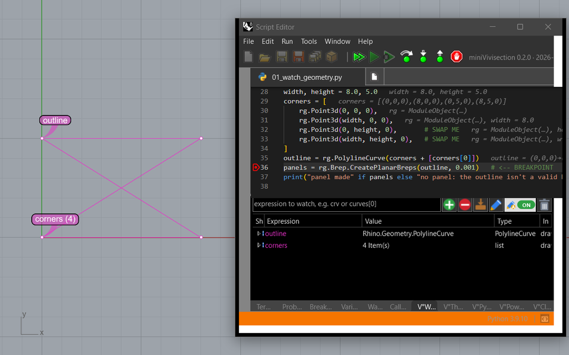

# miniVivisection

A debugger companion for Rhino 8's Script Editor and Grasshopper: while a script is paused, see what its variables hold as geometry in Rhino, change it there and write it back. **Beta.**



## What it does

- **V°Watch:** watched values drawn in Rhino -- points, curves, meshes, planes, vectors -- and changed with Rhino's own tools (*Edit in Rhino*), written back into the paused script.
- **In the code:** values in the tooltips and at the ends of lines; breakpoints with conditions, hit counts and log messages; Break now (Ctrl+Alt+B); Rhino stays usable while a script is paused.
- **Threads and runs:** V°Threads, a freeze guard, *Stop and record* for RunPythonScript.
- **Grasshopper:** script components debug from their editor; which run, branch and item failed; Grasshopper stays usable while a component is paused; V°Edit, V°Text and V°Protect components; Markdown in Panels.
- **Prompts:** V°Python and V°PowerShell on the paused script, and V°Claude (Claude Code) in the Script Editor and in Grasshopper -- code Claude wants to run waits for your approval.
- **Lessons:** 17 Script Editor lessons and 12 Grasshopper lessons, from the toolbar.

The full list: *Features at a glance* in the [manual](docs/miniVivisection_Manual.md).

## Requirements

Windows, Rhino 8.36 or later (tested with 8.37). The Script Editor's Python 3 for the Python features; C# scripts are covered in part. Claude Code (the `claude` CLI) for V°Claude.

## Install

In Rhino 8: `PackageManager`, search *miniVivisection*, tick *Include pre-releases*, *Install*, and restart Rhino. Or download the `.yak` package from [restweiss.de/miniVivisection](https://restweiss.de/miniVivisection/) and drag it onto Rhino 8's window. A copy installed from an older zip is removed first with `miniVivisection_Remove_Old_Install.cmd` (on the web page, and in the package's `misc` folder). Details: the manual's *Install*.

miniVivisection relies on internal code of Rhino 8's Script Editor; a Rhino update can break parts of it. Every feature can be switched off.

## Documentation

- [The manual](docs/miniVivisection_Manual.md) (also V°Help in Rhino), and as a [PDF](docs/miniVivisection_Manual.pdf)
- [The examples guide](examples/00_Examples_Guide.md)
- [The web page](https://restweiss.de/miniVivisection/)

## Building from source

```
dotnet build miniVivisection.sln -c Release
cd tests/miniVivisection.Checks && dotnet run
PYTEST_DISABLE_PLUGIN_AUTOLOAD=1 python -m pytest tests/python
```

Tests in Rhino, releases, and how it works inside: the [developer guide](docs/Developer_Guide.md).

## License

MIT ([LICENSE](LICENSE)); the libraries it ships: [THIRD-PARTY-NOTICES.txt](THIRD-PARTY-NOTICES.txt). Not affiliated with Robert McNeel & Associates; Rhino and Grasshopper are trademarks of their owners. The rhinoceros pictures on the web pages were made with AI image generators.
