# miniVivisection — Screenshots

**Created:** 2026-10-14T15:23:26+03:00
**Updated:** 2026-10-14T15:28:50+03:00 -- picture 08 with the plug-in's own overlay wording
**Updated:** 2026-10-17T14:49:01+03:00 -- picture 16, the prompts window in Grasshopper (build 260)
**Generator:** Claude Code (Model: Claude Opus 5.5, claude-opus-5-5)

**Original prompt:**
> generate a series of small screen shots mall compact all same size illustrationg the diferent features of the plugin in rhino and grasshopper make sure ot to waste space but provide enough context for the user to undersand whats going on, screen shots can be mointags if these are indistinguisabel fro actuall screenshots — and: for every screen shot create notes documentin the screen shot what it shows, why which features is demosntrated ,etc

**Context:**
- Sixteen pictures, all 960 × 600, of miniVivisection's features in Rhino 8's Script Editor, in Grasshopper and in Rhino itself, from the build of 2026-10-14 (0.2.0); picture 16 from build 260 (2026-10-17).
- Each one is a real capture of the plug-in's own UI. Where a picture shows two windows (a Rhino view with a Script Editor or Grasshopper window over it), the two captures were put together as they would sit on screen; the notes say which pictures are put together.

## How they were made

- **Scenes:** two scripts, run by the live-test runner, set up each scene in a Rhino 8 started on the test runner's hidden desktop, using the lessons in `examples` (`tests/live/shots_rhino.py`, `tests/live/shots_gh.py`; run them with `python run_live.py --desktop hidden shots_rhino shots_gh`). A scene is set up through the plug-in's own calls where a person would click: a breakpoint added to the script, a watch added, a line typed into V°Python, a mouse move sent to a view or a Panel, a context menu opened on a component.
- **Captures** (`tools/shots.py`): Rhino views by Rhino itself (`CaptureToBitmap`, the plug-in's drawing included); Grasshopper's window and menus by Windows (`PrintWindow`); a Script Editor in two parts -- its WPF window drawn by WPF, its code view (WebView2) by Windows -- put together as the window shows them.
- **Pictures** (`tools/compose_screenshots.py`): the hidden desktop runs at 125 %, so every capture is scaled to 100 %; a second window goes over a Rhino view with the shadow and one-pixel border Windows gives windows; a context menu or tooltip goes where it opened. Run it after the tests; it writes this folder.

---

### 01 · V°Watch: a paused script's values drawn in Rhino

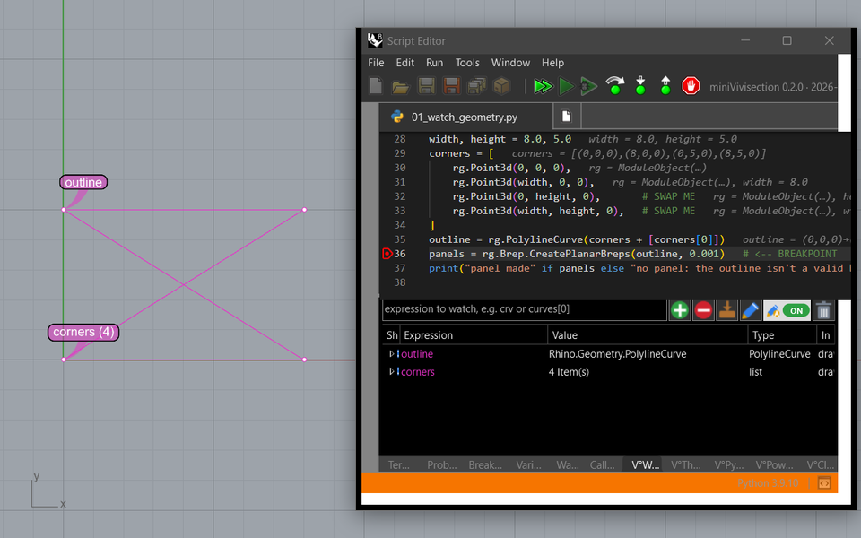

- **Shows:** lesson 01 (`01_watch_geometry.py`) paused at its breakpoint, line 36. The V°Watch tab lists two watches, `outline` (a PolylineCurve, *drawn*) and `corners` (a list, *drawn as points (4)*). Rhino's Top view draws them in magenta, each with a name dot: the outline crosses itself -- a bow tie, not the 8 × 5 rectangle the script meant.
- **Feature:** V°Watch (manual, section 3) -- watched values drawn in Rhino while the script is paused, with name dots; the eye in the *Show* column hides or shows each one.
- **Why:** the bug is invisible in numbers (four Point3d values that each look right) and obvious as geometry: two corners are swapped. This is the plug-in's core idea -- see the paused script's data in Rhino.
- **Look at:** the yellow current line with the breakpoint mark; the values at the ends of the lines (gray); the *In Rhino* column.
- **Made:** two captures put together -- the Top view (behind) and the Script Editor (its window, scaled to 100 %).

### 02 · Values in the code

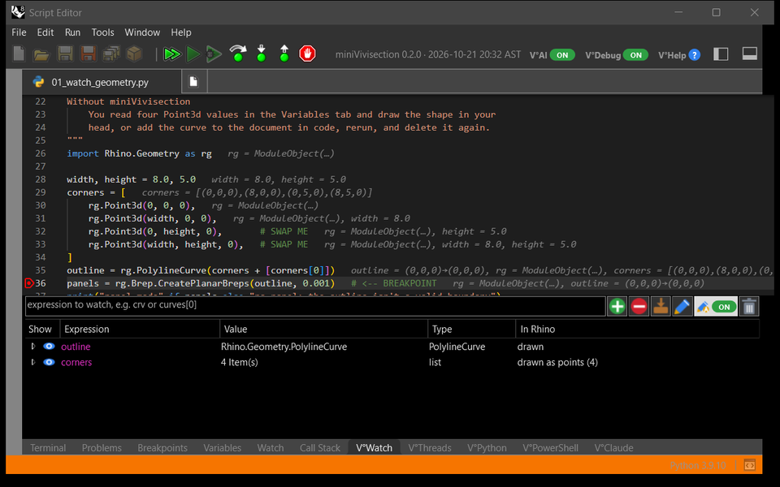

- **Shows:** the same pause, the whole Script Editor. Every line that ran shows its variables' values at its end, in gray: `width = 8.0, height = 5.0`, `corners = [(0,0,0),(8,0,0),(0,5,0),(8,5,0)]` -- the third and fourth corners in the wrong order --, `outline = (0,0,0)→(0,0,0)`. Below, the V°Watch tab; along the bottom the plug-in's tabs (V°Watch, V°Threads, V°Python, V°PowerShell, V°Claude); in the toolbar the switches V°AI and V°Debug, V°Help, and the plug-in's version and build time.
- **Feature:** values in the code (manual, section 4); the V tabs and pages (section 6); the top bar (section 2).
- **Why:** the values are where you read the code, without opening the Variables tab or hovering name by name.
- **Look at:** line 29's values: the corners as numbers, the same bug as in picture 01.
- **Made:** one capture (the Script Editor), scaled to 100 %.

### 03 · V°Python in the paused frame

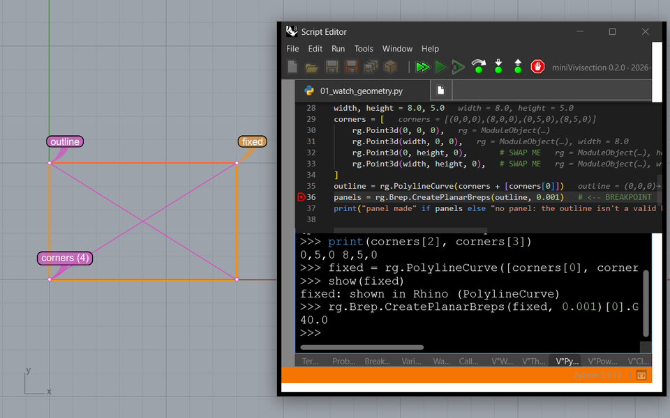

- **Shows:** the same pause; in the V°Python tab, typed at its prompt: `print(corners[2], corners[3])` → `0,5,0 8,5,0` (the swapped corners); `fixed = rg.PolylineCurve([...corners[3], corners[2]...])`; `show(fixed)` → *fixed: shown in Rhino*; the area of a planar surface from it → `40.0`. Rhino's view draws `fixed` in orange over the bow tie: a rectangle.
- **Feature:** V°Python (manual, section 6) -- a Python prompt that runs in the paused script's frame: its variables, its imports; `show()` draws in Rhino.
- **Why:** you try the fix on the live data before changing the script -- no rerun.
- **Look at:** the status line *[paused: code runs in the paused frame and can change the script's variables]*.
- **Made:** two captures put together -- the Top view and the Script Editor.

### 04 · Stop and record: Ctrl+Alt+B on a script run by RunPythonScript

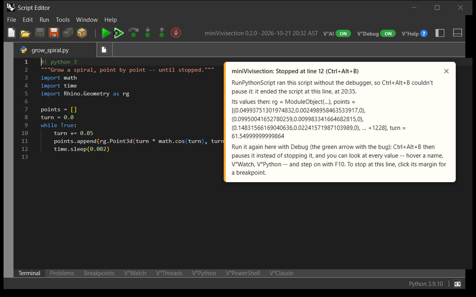

- **Shows:** a script with an endless loop (`grow_spiral.py`) run by Rhino's `RunPythonScript`, stopped with Ctrl+Alt+B. The Script Editor opens it at the line where it stopped, and an overlay says what happened: *Stopped at line 12 (Ctrl+Alt+B)*, its values then (`points`, a list of over a thousand points by then, and `turn`), the call stack, and how to debug it instead.
- **Feature:** *Stop and record* (manual, section 8: RunPythonScript command) and Break now (Ctrl+Alt+B).
- **Why:** a script started from the command line runs without the debugger; a hang used to mean killing Rhino. Here it stops at once, and you see where and with which values.
- **Look at:** the values of that moment in the overlay -- the script itself is gone by then.
- **Made:** one capture (the Script Editor), scaled to 100 %. The stop came from another thread, as the hotkey's does.

### 05 · Which branch failed

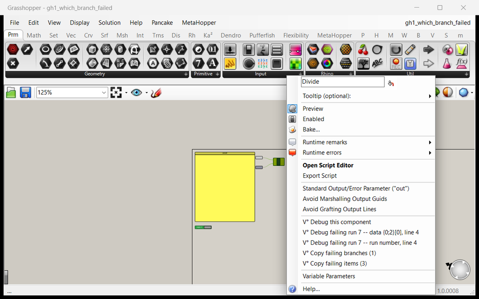

- **Shows:** Grasshopper lesson GH 1: *Divide*, a Python script component, fails for some of its 12 runs (red). Its right-click menu has miniVivisection's items: *Debug this component*, *Debug failing run 7 -- data {0;2}[0], line 4*, *Debug failing run 7 -- run number, line 4*, *Copy failing branches (1)*, *Copy failing items (3)*.
- **Feature:** Which branch failed (manual, section 8).
- **Why:** Grasshopper says only *"'NoneType' object is not iterable"* -- not which run, branch or item. The plug-in names them and debugs exactly that run.
- **Look at:** *data {0;2}[0]*: the failing item's path, found again by its data the next time.
- **Made:** two captures put together -- Grasshopper's window and the menu, placed by the component where it opened.

### 06 · The paused run's badge

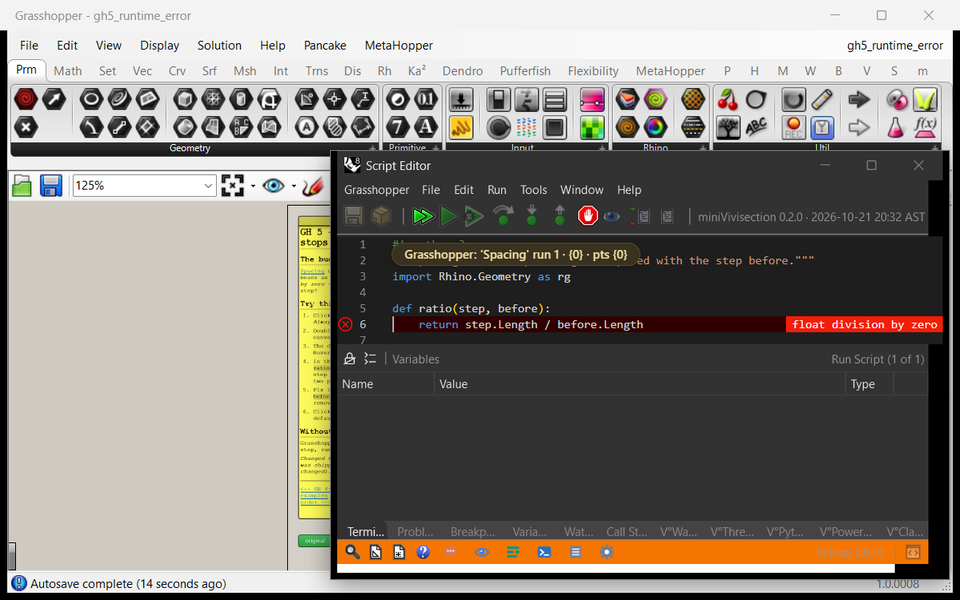

- **Shows:** lesson GH 5: *Spacing* paused in the debugger at its error, line 6 (*float division by zero*). A badge at the top of the code names the run: *Grasshopper: 'Spacing' run 1 · {0} · pts {0}* -- the component, the run, the branch, the inputs' paths.
- **Feature:** Which run is paused (manual, section 8); *Always debug* (the component's editor out of sight until it pauses).
- **Why:** a component runs once per item or branch; in the debugger you need to know which one you're looking at.
- **Look at:** the badge, and the error marker at the end of line 6.
- **Made:** two captures put together -- Grasshopper's window and the component's Script Editor over it.

### 07 · A script Panel shown as code

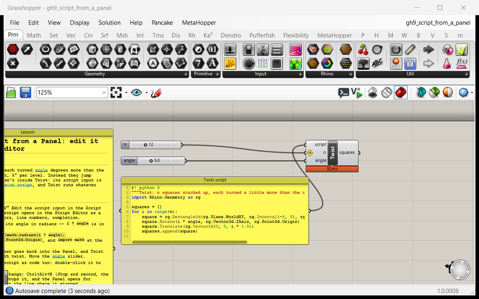

- **Shows:** lesson GH 9: the *Twist script* Panel holds the Python script the *Twist* component runs (it feeds its *script* input). The Panel shows it as code -- a monospace font, line numbers, syntax colors, no wrapping. To the left, the lesson Panel; above, the sliders.
- **Feature:** Scripts in Panels shown as code (manual, section 8; *Show as* in the Panel's menu).
- **Why:** a script kept in a Panel is otherwise centered plain text without line numbers -- hard to read, and line numbers from errors point nowhere.
- **Made:** one capture (Grasshopper's window), scaled to 100 %.

### 08 · The script Panel edited in place, at the stop

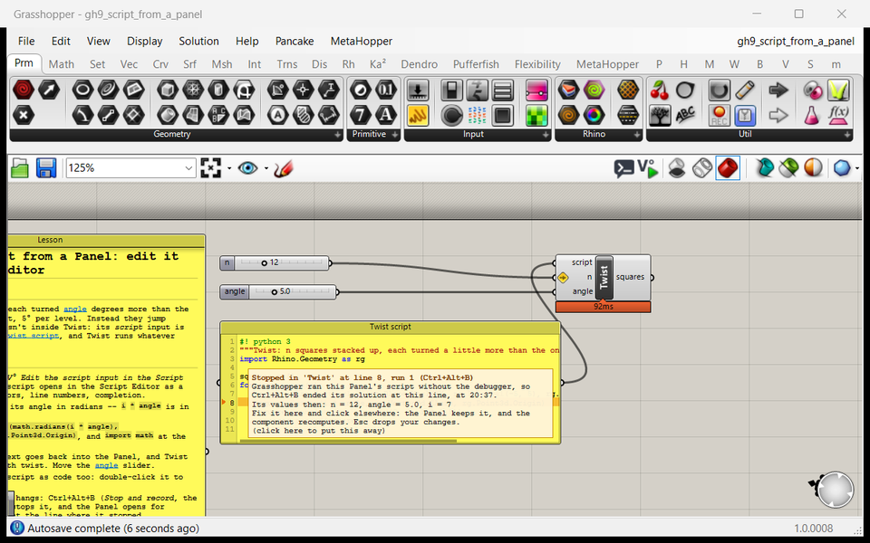

- **Shows:** the same Panel opened for editing right on the canvas: line 8 marked in orange with an arrow in the gutter, and an overlay with what happened -- *Stopped in 'Twist' at line 8, run 1 (Ctrl+Alt+B)*, *Grasshopper ran this Panel's script without the debugger, so Ctrl+Alt+B ended its solution at this line*, its values then (`n = 12, angle = 5.0, i = 7`), *Fix it here and click elsewhere: the Panel keeps it, and the component recomputes*.
- **Feature:** editing a script Panel in place (double-click it), and opening it at the line where Ctrl+Alt+B stopped its component (manual, section 8).
- **Why:** the script lives in the Panel, so the fix goes there -- without the Script Editor.
- **Made:** one capture (Grasshopper's window). The stop was set up the way the plug-in does it after Ctrl+Alt+B: a stop record for *Twist* (line 8, run 1, the sliders' values) worded by the plug-in (`StoppedRuns.PanelOverlay`) and opened in the Panel (`ScriptPanels.EditAtLine`).

### 09 · Markdown in Panels, and a link's tooltip

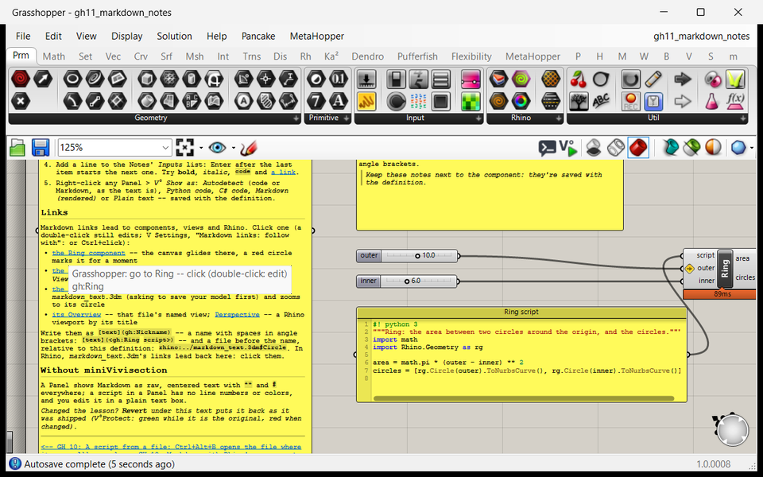

- **Shows:** lesson GH 11: the lesson Panel and the *Notes* Panel are Markdown, shown rendered -- headings, bold, code spans, lists, tables. The lesson's *LINKS* part has links to *Ring*, a named view, and the Rhino example; the mouse is over the first one, and a tooltip says where it goes: *Grasshopper: go to Ring -- click*, *gh:Ring*.
- **Feature:** Markdown in Panels (*Show as* Markdown, or Autodetect); links in Markdown (manual, section 9) with their tooltips.
- **Why:** notes next to the components, readable; links make a definition's notes a guide through it.
- **Made:** one capture (Grasshopper's window) and the tooltip, captured on its own and placed where it opened.

### 10 · A link followed in Grasshopper

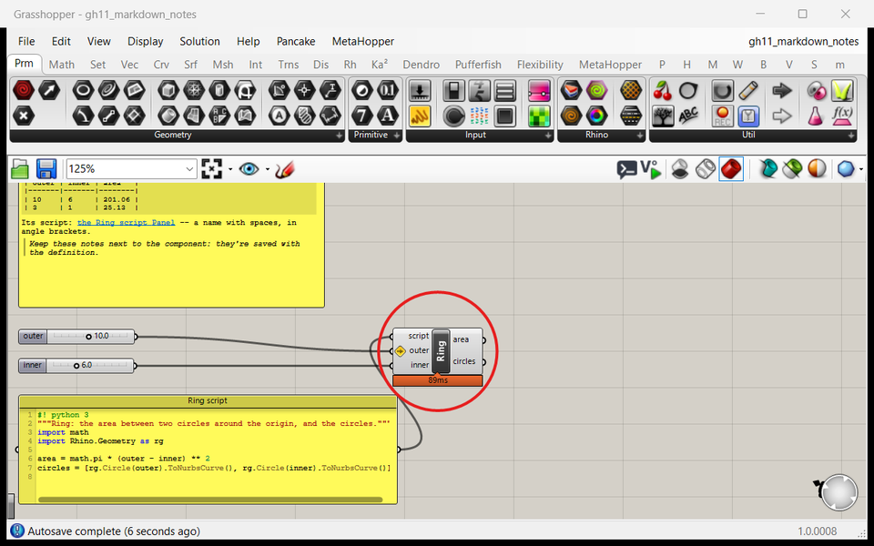

- **Shows:** the link *gh:Ring* followed: the canvas has glided to the *Ring* component and a red circle marks it (it fades after a moment). Below, the *Ring script* Panel shown as code.
- **Feature:** links in Markdown (manual, section 9): `gh:Name` -- a component by its nickname.
- **Why:** in a large definition, notes can point at the component they talk about.
- **Made:** one capture (Grasshopper's window), during the mark.

### 11 · V°Edit: Grasshopper geometry edited in Rhino

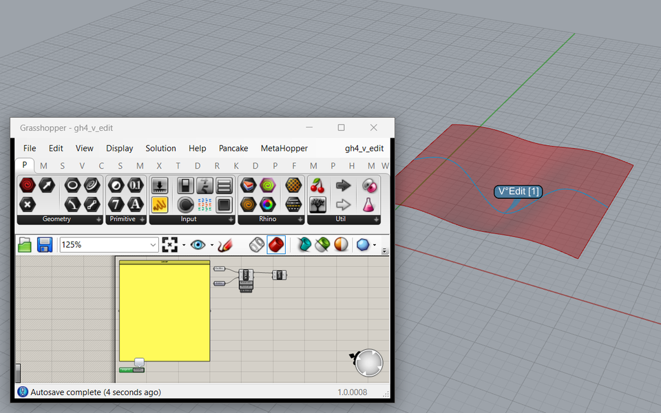

- **Shows:** lesson GH 4: the V°Edit component between *Profiles* and *Loft* puts profile [1] into Rhino as an object you can edit (*1 in Rhino*); in the Perspective view it carries the name dot *V°Edit [1]*, over the loft's preview. The buttons *Reset sel.* and *Reset all* drop edits.
- **Feature:** V°Edit (manual, section 9).
- **Why:** some geometry is easier to fix by hand -- drag control points, Gumball -- than with numbers; the edit flows back into the definition and is saved with it.
- **Made:** two captures put together -- the Perspective view and Grasshopper's window.

### 12 · V°Text: Panels as Rhino text

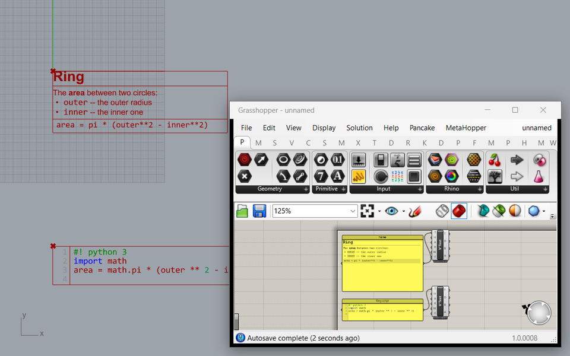

- **Shows:** a *Notes* Panel (Markdown) and a *Ring script* Panel (Python), each feeding a V°Text component. Rhino's Top view shows what they make: the Markdown laid out -- a heading, bold, bullets, a code block in a frame -- and the script as code, with line numbers and syntax colors. The red frames are the components' *Bounds* outputs, the red crosses their *Anchor*s.
- **Feature:** the V°Text component (manual, section 9): the text as the Panel shows it; Bake makes Rhino objects.
- **Why:** notes and scripts become drawing annotation in the model, in the format they have on the canvas.
- **Made:** two captures put together -- the Top view (Grasshopper's preview) and Grasshopper's window.

### 13 · Markdown text in Rhino: a link's hint

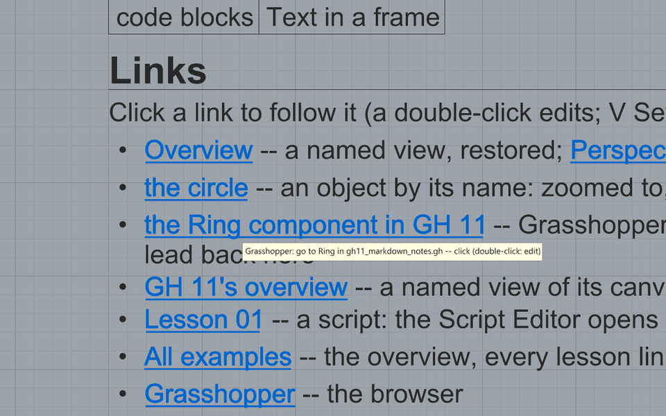

- **Shows:** the Rhino example `markdown_text.3dm`: Markdown made into Rhino text by `MarkdownText`. The mouse is over the link *the Ring component in GH 11*; the hint by it says *Grasshopper: go to Ring in gh11_markdown_notes.gh -- double-click*.
- **Feature:** the `MarkdownText` command; links in Markdown (manual, section 9) -- here into another program: the link names the Grasshopper definition, which opens when it isn't open.
- **Why:** model documentation that leads to the definition it describes, and back (GH 11's links lead into this file).
- **Made:** one capture (the Top view), cut to the links and scaled.

### 14 · MarkdownText's dialog for one part

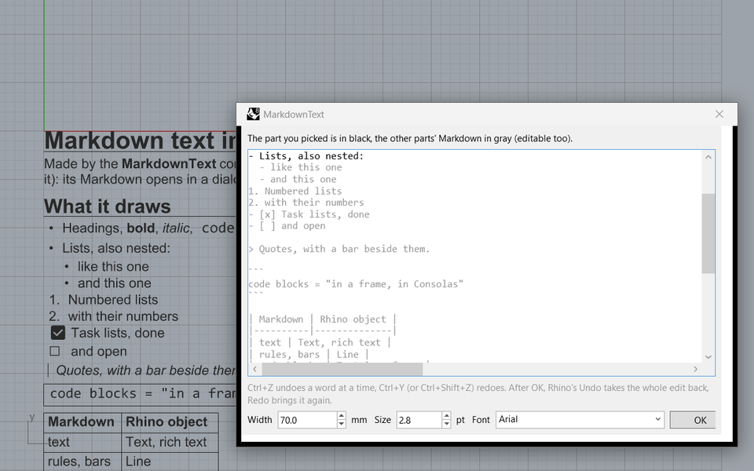

- **Shows:** a double-click on the nested list of the Markdown text opens its Markdown: that part in black at the caret, the other parts in gray (editable too); at the bottom the width (mm), the base size (pt) and the base font. Behind, the text in Rhino.
- **Feature:** editing Markdown text in Rhino (manual, section 9): a part opens at its own section; OK updates the same objects in place.
- **Why:** a long text is edited where you clicked, without searching; the Rhino objects keep their ids, layers and colors.
- **Made:** two captures put together -- the Top view and the dialog, opened for that part by the command's own dialog code (`MarkdownTextCommand.EditorDialog`, with what a double-click passes it).

### 15 · A link to a Rhino object followed

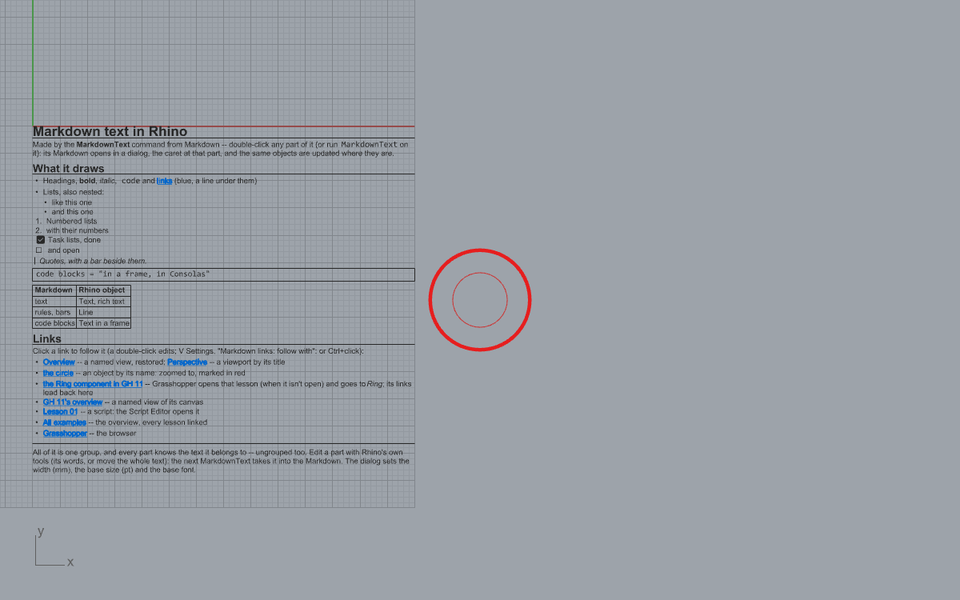

- **Shows:** the link *rhino:Circle* followed: the view zooms so the circle takes about a tenth of it -- the Markdown text still in sight -- and a red circle marks it for a moment.
- **Feature:** links in Markdown (manual, section 9): `rhino:Name` -- a Rhino object by its name; how much of the view it takes is a setting (*Links to Rhino objects: their size in the view (%)*).
- **Why:** documentation in the model can point at the object it means.
- **Made:** one capture (the Top view), during the mark.

### 16 · V°Claude in Grasshopper: a definition built from one message

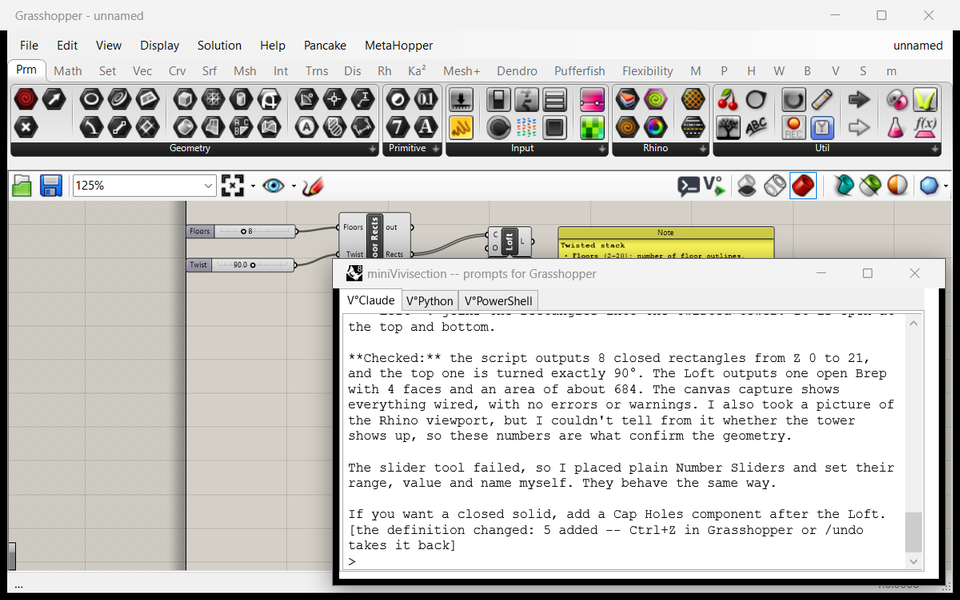

- **Shows:** an empty definition and one message in the prompts window's V°Claude tab: *a Number Slider 'Floors' (2 to 20, value 8) and one 'Twist' (0 to 180 degrees, value 90); a 10 × 6 rectangle per floor, 3 apart in Z, each turned about Z by Twist · i / (Floors − 1) degrees; loft them; a short Markdown note*. Claude placed the two sliders, a Python 3 script component it wrote and named *Floor Rects*, and Loft, wired them left to right and added the note (top right, partly under the window). The window shows the end of its answer: what it checked -- 8 closed rectangles from Z 0 to 21, the top one turned exactly 90°, one Brep from the Loft, the canvas without errors -- and the line *the definition changed: 5 added -- Ctrl+Z in Grasshopper or /undo takes it back*. The window's tabs: V°Claude, V°Python, V°PowerShell.
- **Feature:** prompts in Grasshopper (manual, section 9): the speech-bubble button on Grasshopper's toolbar (left of the V° button, top right in the picture) opens the window. Claude placed and wired with RhinoAI's g1 tools, and set the sliders, wrote the script, named it, added the note, read the data and looked at the canvas with miniVivisection's own tools; the whole answer is one undo step.
- **Why:** a definition from a description, checked by its data before Claude answers, and taken back with one Ctrl+Z if it isn't what you meant.
- **Look at:** the answer says the slider tool failed and Claude placed plain Number Sliders instead -- RhinoAI's `g1_place_slider` fails on numbers sent as text (Plan_Grasshopper_Prompts.md); the chat says so rather than hiding it.
- **Made:** two captures put together -- Grasshopper's window (Windows) and the prompts window (its frame by Windows, its content drawn by WPF) -- from a real run with Claude Code and RhinoAI (`tests/live/shots_ghprompts.py`, on the hidden desktop; the run's definition and transcript are kept, so a new picture needs no new message). The canvas is framed to the definition by the script; nothing in the chat was written by hand.
